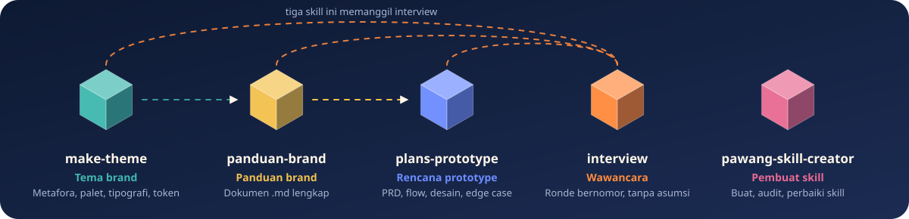

<div align="center">



<br>

[](https://github.com/pawangai/pawang-skills/actions/workflows/ci.yml)
[](https://github.com/pawangai/pawang-skills/releases)
[](LICENSE)
[](https://github.com/pawangai/pawang-skills/stargazers)


[Skill](#daftar-skill) · [Memasang](#memasang) · [Dependensi](#dependensi) · [Pengembangan](#pengembangan) · [Struktur](#struktur)

</div>

---

Skill (format Agent Skills) milik Pawang, dengan marketplace untuk Claude Code dan Codex, dan paket ZIP untuk aplikasi chat. Satu folder per skill di `skills/`. Lisensi MIT.

## Daftar skill

<div align="center">

</div>

| Skill | Fungsi |
|---|---|
| `interview` | Mewawancarai user per ronde bernomor dengan rekomendasi jawaban, supaya tidak ada keputusan atau asumsi diam-diam. Mode penuh dan mode ringan. |
| `make-theme` | Merancang tema brand (metafora, tone of voice, palet HEX dengan cek kontras, tipografi, tagline, pilar layanan), opsional blueprint SEO/AEO/GEO dan kode tema. Berisi `scripts/check_theme.py`. |
| `panduan-brand` | Membuat panduan brand lengkap sebagai berkas Markdown. |
| `plans-prototype` | Menghasilkan 4 dokumen perencanaan prototype (PRD, flow, desain, edge case), lalu memandu iterasi prototype. |
| `pawang-skill-creator` | Membuat, mengaudit, dan memperbaiki skill baru. Berisi `scripts/validate_skill.py`. |

Urutan pemakaian: `panduan-brand` → `plans-prototype`. `make-theme` berdiri sendiri; hasilnya bisa dijadikan bahan `panduan-brand`. `interview` dipanggil ketiganya bila ada keputusan yang belum jelas, jadi pasang `interview` bersama skill lain.

Skill brand board tidak lagi ada di repo ini. Pakai `brandboard-standard` dari `pawang-content-studio`:

```bash
npx skills add pawangai/pawang-content-studio --skill brandboard-standard
```

## Memasang

Tidak ada satu marketplace untuk semua agent, jadi ada tiga jalur.

### 1. Agent CLI (OpenCode, Pi, Antigravity, Gemini CLI, Codex, Claude Code, Cursor, Copilot, dan lainnya)

```bash
npx skills add pawangai/pawang-skills                    # pilih skill dan agent secara interaktif
npx skills add pawangai/pawang-skills --all -g           # semua skill, semua agent terdeteksi, tingkat user
npx skills add pawangai/pawang-skills --skill interview  # satu skill
```

CLI mendeteksi agent yang terpasang dan menaruh skill di direktori masing-masing.

### 2. Marketplace bawaan

| Agent | Perintah |
|---|---|
| Claude Code | `/plugin marketplace add pawangai/pawang-skills` lalu `/plugin install pawang-skills@pawang` |
| Codex | `codex plugin marketplace add pawangai/pawang-skills` lalu `codex plugin add pawang-skills@pawang` |
| Gemini CLI | `gemini skills install https://github.com/pawangai/pawang-skills.git --path skills` |

Pembaruan: `/plugin marketplace update pawang` (Claude Code), `codex plugin marketplace upgrade pawang` (Codex).

### 3. Aplikasi chat (claude.ai, ChatGPT, Gemini app, Perplexity)

Aplikasi ini tidak punya marketplace berbasis URL. Unduh ZIP per skill dari halaman [Releases](https://github.com/pawangai/pawang-skills/releases) lalu unggah satu per satu:

| Aplikasi | Cara |
|---|---|
| claude.ai | Menu Skills di pengaturan, unggah `<nama>.zip` atau `<nama>.skill` |
| ChatGPT | Customize → Skills → "+" → Create skill → Upload a skill, unggah `<nama>.zip` |
| Gemini app | Settings → Skills → Upload, unggah `<nama>.zip` |
| Perplexity | Hanya lewat API Portal sebagai custom skill (ZIP berisi satu folder dan satu `SKILL.md`) |

Catatan: `plans-prototype` dan `make-theme` berisi skrip Python, dan sebagian aplikasi chat dilaporkan menolak paket berskrip. Bila unggahan ditolak, buka issue.

## Dependensi

- `plans-prototype` memanggil `interview` untuk wawancara (langkah 0).
- `make-theme` memanggil `interview` mode ringan untuk discovery; bila tidak terpasang, skill bertanya langsung.
- `plans-prototype` membaca kontrak dokumen milik skill `plan` Pawang (`references/contract.md`, opsi `--reader` di `check_contract.py`). Skill `plan` **tidak ada di repo ini**.
- `panduan-brand` menyebut tool runtime Pawang (`SendUserFile`, `WebSearch`). Di agent lain, ganti dengan tool setara.
- Python 3 tanpa paket tambahan untuk semua skrip.

## Pengembangan

```bash
scripts/validate-all.sh         # validasi skill, manifest, eval, dan unit tests
python3 scripts/validate_evals.py # validasi definisi behavioral eval saja
python3 -m unittest discover -s tests -p 'test_*.py' -v
scripts/package.sh              # semua skill -> dist/<nama>.zip dan dist/<nama>.skill
scripts/package.sh interview    # satu skill
```

`validate-all.sh` memeriksa: `name` sama dengan folder, `license`, `compatibility`, dan `metadata.author` di frontmatter; hasil `validate_skill.py`; JSON manifest, nama, dan sinkronisasi versi; sintaks skrip Python; definisi behavioral eval; serta unit tests. Aturan perubahan ada di `AGENTS.md`.

### Behavioral evaluation

`tests/evals/cases.json` berisi tiga skenario perilaku per skill (happy path, edge case, dan adversarial), ditambah lima prompt yang seharusnya mengaktifkan dan lima prompt near-miss yang tidak seharusnya mengaktifkan setiap skill. `scripts/validate_evals.py` memeriksa kelengkapan dan konsistensi definisi tersebut; unit tests menguji validatornya.

Validasi ini **tidak menjalankan model AI** dan tidak membuktikan perilaku runtime. Untuk evaluasi perilaku, jalankan setiap prompt pada agent/model target, simpan responsnya, lalu nilai dengan kriteria `must` dan `must_not` pada kasus terkait. Gunakan `tests/evals/RESULTS_TEMPLATE.md` untuk mencatat model, harness, tanggal, baseline tanpa skill, dan hasil sebelum menyatakan skill teruji.

## Struktur

```
skills/<nama>/SKILL.md          # sumber tunggal semua skill
assets/                         # gambar animasi SVG untuk README
.claude-plugin/                 # plugin dan marketplace Claude Code
.codex-plugin/                  # plugin Codex
.agents/plugins/marketplace.json  # marketplace Codex
scripts/                        # validasi dan pengemasan
.github/workflows/              # CI dan rilis
```
