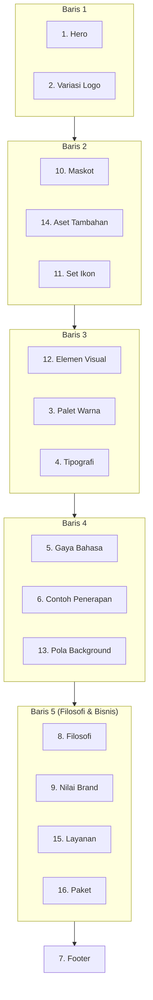

# Spesifikasi Section Brand Board

Daftar isi:
1. Layout kanvas
2. Tier 1 (wajib, sections 1-7)
3. Tier 2 (kondisional di bertingkat, sections 8-14)
4. Tier 3 (modul bisnis, sections 15-16)
5. Asal-usul standar

Setiap section di Tier 2 dan 3 punya **versi minimal**. Versi minimal hanya dipakai di cakupan lengkap, saat brand tidak punya elemen tersebut. Isinya diturunkan dari logo, tagline, dan bidang usaha. Section yang seluruhnya berisi versi minimal ditandai `[ASUMSI]` sekali di judul section (contoh: `### 10. Maskot [ASUMSI]`), bukan per baris.

---

## 1. Layout kanvas

Format: lanskap 3:2 (contoh 1536 x 1024 px). Grid berbaris, terbaca dari atas ke bawah. Posisi tiap section tetap antar brand.

Urutan section di prompt gambar (mengikuti layout di atas, bukan urutan nomor):

| Posisi | Baris | Section (nomor) |
|---|---|---|
| 1 sampai 2 | 1 | Hero (1), Variasi Logo (2) |
| 3 sampai 5 | 2 | Maskot (10), Aset Tambahan (14), Set Ikon (11) |
| 6 sampai 8 | 3 | Elemen Visual (12), Palet Warna (3), Tipografi (4) |
| 9 sampai 11 | 4 | Gaya Bahasa (5), Contoh Penerapan (6), Pola Background (13) |
| 12 sampai 15 | 5 | Filosofi (8), Nilai Brand (9), Layanan (15), Paket (16) |
| 16 | Penutup | Footer (7) |

Brand Spec tetap memakai urutan nomor 1 sampai 16.

Aturan layout:
- Footer (7) selalu paling bawah, walau nomornya di Tier 1.
- Di cakupan bertingkat, section yang dilewati diganti dengan pelebaran section tetangga. Jangan memindahkan section ke baris lain.
- Baris 5 boleh dipindah ke bawah Hero (Baris 1b) bila brand berbasis jasa dan cerita lebih penting daripada aset visual. Pindahkan seluruh baris, jangan per section.

---

## 2. Tier 1: Wajib

### 2.1 Hero
Elemen wajib (tetap):
- Logo utama (horizontal), tagline, 1 ilustrasi/visual utama
- 1 kalimat pendamping (quote atau slogan singkat)
- 1 **penanda nilai**, bentuknya ditentukan oleh Hero archetype di bawah

**Hero archetype** (pilih satu, catat alasannya satu kalimat di Ringkasan Brand Spec):

| Archetype | Bentuk penanda nilai | Cocok untuk |
|---|---|---|
| Pilar | 2 sampai 4 kata dipisah `•` (contoh `KATA • KATA • KATA`) | Brand dengan beberapa nilai setara, B2B |
| Manifesto | Satu pernyataan sikap, 1 sampai 2 baris | Brand beropini, komunitas |
| Bukti | Satu angka atau fakta yang bisa diverifikasi (contoh "dibalas < 1 jam") | Brand jasa. Angka harus dari user, bila tidak ada tandai `[ASUMSI]` |
| Sapaan | Satu kalimat percakapan, atau maskot/simbol yang "berbicara" | Brand ramah, B2C |
| Minimal | Tidak ada elemen tambahan; logo, tagline, dan visual utama saja | Brand premium atau tenang |

Aturan pemilihan:
- Pilar bukan default. Pakai hanya bila brand memang punya beberapa nilai setara; bila tidak, pilih archetype lain.
- Dalam satu set atau satu sesi yang menghasilkan beberapa brand, jangan memakai archetype yang sama berurutan kecuali user memintanya.
- Pada archetype Minimal, "1 penanda nilai" dipenuhi oleh tagline itu sendiri.
- Layout kanvas tidak berubah: posisi Hero tetap, hanya isi bagian penanda nilainya yang berganti bentuk.

### 2.2 Variasi Logo
Enam varian, masing-masing berlabel:
1. Horizontal (utama)
2. Vertikal
3. Ikon / app icon
4. Minimalis (simbol saja, satu warna)
5. **Versi gelap** (logo di latar gelap)
6. Favicon (tetap terbaca di 32 px)

Opsional: stempel/lencana (cocok untuk brand berbasis komunitas atau tradisi).

### 2.3 Palet Warna
- 4 sampai 6 warna
- Tiap warna: **nama**, **hex**, **peran** (misalnya "aksen/CTA", "latar", "teks pada gelap")
- Minimal ada: 1 warna utama, 1 aksen, 1 latar terang, 1 warna teks gelap
- Catat pasangan teks-latar yang lolos kontras 4.5:1

### 2.4 Tipografi
Tiga peran wajib, tiap peran punya nama font, label penggunaan, dan contoh:

| Peran | Contoh pelabelan |
|---|---|
| Judul / Headline | `Font A (untuk judul & highlight)` |
| Isi / Body | `Font B (untuk isi / body)` |
| Kode / Teknis | `Font C monospace (untuk kode / label teknis)` |

Sertakan satu contoh kalimat nyata (bukan lorem ipsum), dan satu contoh snippet kode bergaya aksen bila brand bergerak di bidang teknologi.

### 2.5 Gaya Bahasa
1. **Deskripsi tone** (1 kalimat)
2. **Contoh kutipan** (minimal 2, tiap kutipan diberi label sifat)
3. **Microcopy per konteks UI**, tabel minimal 6 baris: Hero, Tombol CTA, Loading, Sukses, Error 404, Email konfirmasi
4. **Checklist prinsip** (4 sampai 5 butir perilaku brand, format `☑ Prinsip`)

### 2.6 Contoh Penerapan
Minimal 3 konteks berbeda, dipilih dari: kartu/post sosmed, profil sosmed (bio + avatar), dashboard/UI aplikasi, chat (WhatsApp/Telegram), mockup HP dengan app icon, merchandise, banner dengan CTA, quote banner.

### 2.7 Footer
- Logo kecil, deskripsi satu baris (apa yang brand lakukan), tagline
- Jangan mengulang penanda nilai Hero secara persis; Footer cukup tagline
- Fungsinya penutup visual yang konsisten di semua board

---

## 3. Tier 2: Kondisional (bertingkat) / wajib (lengkap)

### 3.1 Section 8: Filosofi
- 2 sampai 4 paragraf pendek; kalimat pembuka berupa pernyataan posisi
- **Versi minimal:** 1 paragraf 2 sampai 3 kalimat, diturunkan dari tagline dan bidang usaha

### 3.2 Section 9: Nilai Brand
- 3 sampai 5 butir, tiap butir punya ikon, nama nilai, dan 1 kalimat penjelas
- **Versi minimal:** 3 butir yang diturunkan dari tagline dan target audiens (bukan disalin dari penanda nilai Hero, supaya tidak terjadi pengulangan di satu board)

### 3.3 Section 10: Maskot
- 4 versi berbasis konteks, tiap versi berlabel pendek:
  1. Utama (semangat & siap membantu)
  2. Komunikatif (aktif di chat / respons cepat)
  3. Berpikir (analisis & solusi)
  4. Santai (setelah selesai)
- 6 ekspresi tambahan (kepala saja)
- **Versi minimal** (brand tanpa karakter): simbol logo sebagai "karakter", digambar dalam 4 konteks di atas dengan perubahan sederhana (warna, ikon kecil, pose bentuk), dan 6 varian ekspresi berupa status ikon (aktif, loading, sukses, error, idle, notifikasi). Jangan menciptakan tokoh manusia atau hewan baru tanpa persetujuan user

### 3.4 Section 11: Set Ikon
- Minimal 8 ikon dalam 1 gaya (garis atau solid, jangan campur), tiap ikon berlabel 1 kata
- Cakupan disarankan: Kode, Dokumentasi/Ilmu, Keamanan/Amanah, Komunikasi, Progres, Tepat Waktu, plus 2 ikon khas brand
- **Versi minimal:** tidak ada, 8 ikon selalu bisa dibuat

### 3.5 Section 12: Elemen Visual
- Ornamen (siluet, bunga, daun, garis pemisah) minimal 6 elemen
- Komponen UI bergaya brand (progress bar, toggle)
- **Versi minimal:** 6 elemen geometris yang diturunkan dari bentuk logo, plus 1 progress bar dan 1 toggle

### 3.6 Section 13: Pola Background
- 1 pola seamless dengan opasitas rendah, plus 1 pembatas dekoratif
- Aturan pemakaian: opasitas maksimal, tidak di belakang body text
- **Versi minimal:** pola yang diulang dari bentuk logo atau elemen geometris section 12

### 3.7 Section 14: Aset Tambahan
- 3 sampai 5 properti pendukung (aset kerja, buku, cangkir, tanaman), dipakai konsisten sebagai props di ilustrasi
- **Versi minimal:** 3 properti sederhana yang relevan dengan bidang usaha

---

## 4. Tier 3: Modul Bisnis

### 4.1 Section 15: Layanan
- 3 sampai 4 kartu layanan; tiap kartu: ikon, nama, deskripsi 1 kalimat, tagline dalam tanda kutip
- **Versi minimal:** 3 kartu berdasarkan bidang usaha. Nama layanan ditandai `[ASUMSI]` dan perlu dikonfirmasi user

### 4.2 Section 16: Paket
- 2 sampai 4 tingkat sesuai brief; tiap tingkat punya nama, warna sendiri, dan 1 kalimat ruang lingkup
- Jangan mencantumkan harga kecuali diberikan user
- **Versi minimal:** 3 tingkat generik (dasar, menengah, premium) tanpa harga, ditandai `[ASUMSI]`

---

## 5. Asal-usul standar

Tabel ini menunjukkan board referensi mana yang menjadi sumber tiap section, supaya perubahan standar bisa ditelusuri.

| Elemen standar | Sumber utama |
|---|---|
| Filosofi, Nilai, Layanan, Paket | Pawang.dev |
| Palet dengan kolom peran | Pawang.dev, DukunKode |
| Versi logo gelap | Pawang.dev |
| Microcopy per konteks UI | DukunKode |
| Variasi logo (stempel, minimalis) | Gus Kode, Ning Kode |
| Maskot 4 versi + 6 ekspresi | Gus Kode, Ning Kode |
| Aset tambahan, Set ikon 8 | Gus Kode, Ning Kode |
| Pola background (section sendiri) | Gus Kode |
| Checklist prinsip perilaku | Ning Kode |
| Contoh chat & dashboard | Ning Kode |
| Label penggunaan tiap font | Ning Kode |
| Footer | Gus Kode, DukunKode |
| Hero archetype (Pilar sebagai salah satu opsi) | Keempat board referensi memakai Pilar; archetype lain ditambahkan untuk variasi |
