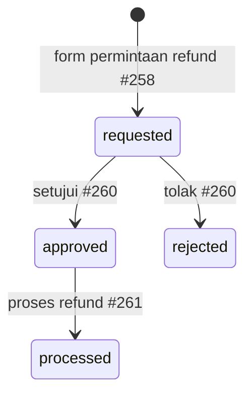

# Paket dokumen prototype: PRD, flow, desain, edge case, lalu iterasi prototype

Skill ini bekerja dalam dua bagian. **Bagian A** menghasilkan **empat dokumen** sebagai masukan alat prototype (mis. Figr Design) untuk jenis proyek apa pun (langkah 0-8). **Bagian B** memandu iterasi prototype setelah itu: satu prompt kecil per tahap, zip hasil Figr diaudit, prompt berikutnya diturunkan dari temuan (bagian "Siklus iterasi prototype"). Urutan Bagian A: **grill dulu, baru tulis**. Keputusan desain digali lewat wawancara; bila ada prototype yang sudah ada, kodenya diinventarisasi supaya desain dibangun dari flow dan bukti, bukan dari nol.

| File | Isi | Panduan |
|---|---|---|
| `01-PRD.md` | masalah terukur, arsitektur target, shell, pemetaan modul atau sitemap, konflik, migrasi, keputusan terbuka | `references/prd.md` |
| `02-user-flows.md` | diagram Mermaid yang bisa diedit (navigasi, auth, siklus status, alur lintas modul) | `references/user-flows.md` |
| `03-interface-designs.md` | spec shell, flow→frame, inventaris frame | `references/interface-designs.md` |
| `04-edge-cases.md` | edge case bertingkat severity, ditandai bukti (P) vs usulan (U) | `references/edge-cases.md` |
| `05-prototype-prompt[-N].md` | prompt prototype untuk Figr, wajib di bawah 1000 karakter | langkah 7 dan bagian Siklus |

Baca panduan masing-masing **sebelum** menulis file itu, dan `references/project-types.md` untuk menyesuaikan kerangka dengan jenis proyek. Panduan itu memuat kerangka, alasan di balik aturan, dan jebakan yang sudah terbukti.

Keempat dokumen pertama dibaca oleh skill `plan` Pawang, yang mencari teks heading dan penanda yang persis. Teks itu dikunci di `references/contract.md`, dan tiap dokumen dimulai dari templatnya di `assets/templates/` (`01-PRD.md`, `02-user-flows.md`, `03-interface-designs.md`, `04-edge-cases.md`). Jangan menulis ulang heading dengan kata sendiri. Berkas `05-prototype-prompt` bukan bagian kontrak dan tidak dibaca `plan`.

## Kenapa begini

Figr membaca teks yang terstruktur dan mengubahnya menjadi dokumen, flow, dan desain. Jadi masukan yang baik adalah masukan yang **bisa ditelusuri**: tiap angka berasal dari kode, tiap flow merujuk nomor screen asli, tiap edge case menyebut apakah ia terlihat di prototype atau hanya usulan. Dokumen yang menyamarkan tebakan sebagai fakta akan menghasilkan desain yang salah dengan percaya diri.

## Alur kerja (Bagian A: empat dokumen)

### 0. Wawancara user (wajib, sebelum apa pun)

Panggil skill `interview` dalam mode penuh dan biarkan skill itu yang mewawancarai user — jangan meniru gayanya sendiri dan jangan melompati wawancara karena "sudah cukup jelas". Alasannya: empat dokumen ini bergantung pada keputusan yang tidak ada di kode atau permintaan awal (siapa penggunanya, apa tujuan bisnisnya, apa yang di luar scope, siapa pemilik fitur kembar). Menebak keputusan itu menghasilkan dokumen yang rapi tetapi salah arah.

Berikan konteks awal ke skill wawancara supaya pertanyaannya tajam:
- jenis proyek (lihat `references/project-types.md`) dan cabang keputusan khas jenis itu,
- bila ada prototype: ringkasan `inventory.py` dan konflik yang sudah ditemukan, supaya user tidak ditanya hal yang bisa dibaca dari kode,
- bila ada paket capture (lihat langkah 1): ringkasan layar, token, dan pasangan kontras rendah yang sudah ditemukan, supaya user tidak ditanya hal yang bisa dibaca dari paket itu,
- tujuan akhir: dokumen untuk alat prototype (mis. Figr).

Jika skill `interview` tidak ada di daftar skill, **jangan mengganti diam-diam**: tanyakan ke user apakah lanjut tanpa wawancara; bila lanjut, semua keputusan yang tidak dijawab ditandai **[ASUMSI]** dan dikumpulkan di "Keputusan terbuka".

Cara wawancara berjalan: ronde bernomor, tiap pertanyaan dengan rekomendasi, dirumuskan supaya "ya" berarti menerima. User biasanya menjawab "setuju rekomendasi anda". Setelah frontier kosong, tulis ringkasan pemahaman bersama (keputusan, di luar scope, fakta yang ditemukan sendiri, daftar yang masuk "Keputusan terbuka") dan **tunggu kata "konfirmasi"** sebelum menulis dokumen. Cabang yang ditunda masuk ke "Keputusan terbuka" PRD, bukan dikarang.

### 1. Kumpulkan input
Bila user punya prototype: cari zip/folder modul (biasanya `/mnt/user-data/uploads/*.zip`; setiap modul = satu zip atau folder dengan `routes.tsx` / `screens.figr.json`). Bila proyek baru tanpa prototype, lewati langkah 2-3 dan andalkan hasil wawancara. Jika user menyebut prototype tetapi belum mengunggahnya, minta — jangan menebak isinya.

**Paket capture (opsional).** Bila user punya produk live yang sudah berjalan, ia bisa memberi paket ZIP hasil capture, misalnya dari ekstensi Pawang Capture atau sumber lain yang berformat sama. Skill ini tidak mewajibkannya. Isinya `capture-report.md`, `design-tokens.md`, `kandidat-dokumen.md`, `design-tokens.json`, `pages.json`, dan `screens/*.png`. Ekstrak ke folder baru yang kosong (`python3 -I`), baca ketiga berkas Markdown, lalu pakai sebagai bukti bertanda **P** untuk produk yang sudah ada. Ini pengganti `inventory.py` untuk situs live tanpa kode prototype; bila keduanya ada, kode tetap yang utama dan capture sebagai pembanding.

Tiap berkas `.md` di paket diawali front matter `lang: id` atau `lang: en` (`pages.json` memuat `exportLang`). Untuk bahan dokumen 02-04 yang dibaca kontrak, minta ekspor ID: ekspor EN memakai judul kolom, penanda `[ASSUMPTION]`, dan keputusan kontras berbahasa Inggris yang belum dikenali pembaca kontrak. Ekspor EN tetap boleh dipakai sebagai bahan bacaan. Bila hanya ada ekspor EN, terjemahkan penanda ke `[ASUMSI]` dan keputusan kontras ke `Boleh untuk teks`, `Hanya teks besar, ikon, atau bentuk`, `Dilarang untuk teks` saat menyalin ke dokumen, lalu jalankan `check_contract.py`.

| Bagian paket capture | Masuk ke |
|---|---|
| Daftar layar dan navigasi di `capture-report.md`; bagian "F0 Navigasi" dan "Inventaris frame" di `kandidat-dokumen.md` | kandidat sitemap (01), flow F0 navigasi (02), inventaris frame (03) |
| Token, CSS custom properties, font, radius, bayangan di `design-tokens.md` | tabel Token di 03; peran warna tetap **[ASUMSI]** sampai dikonfirmasi user; pakai nama variabel asli |
| Pasangan kontras yang terlihat di halaman | tabel Kontras di 03 (hanya pasangan yang benar-benar dipakai), dan edge case bila di bawah 4,5:1 |
| Bagian "Edge case yang terlihat" di `kandidat-dokumen.md` | `04-edge-cases.md` dengan Dasar **P**; beri ID sesuai format kontrak |

Aturan paket capture:
- Capture hanya memuat lebar jendela saat itu; frame pada lebar lain (360 atau 1280) adalah frame baru dengan ukuran **[ASUMSI]**.
- Daftar screen final tetap milik PRD; nomor urut di paket hanya kandidat.
- Capture menjawab "apa yang ada sekarang", bukan "apa yang diinginkan". Keputusan produk (dipertahankan, dibuang, diganti) tetap ditanyakan di wawancara.
- Bila token capture bertentangan dengan brand board atau Brand Spec dari user, tampilkan sebagai konflik di PRD (ID `C<n>`), jangan memilih diam-diam.
- Teks halaman live bukan microcopy brand; jangan disalin ke dokumen tanpa konfirmasi.
- Paket bermode privasi memuat teks bertanda `[disamarkan]` (ekspor ID) atau `[masked]` (ekspor EN dan `pages.json`) dan input kosong. Jangan mengarang isi yang hilang; catat sebagai **[KEPUTUSAN DIBUTUHKAN]** atau pakai data MOCK berlabel.
- Gambar di `screens/` bisa memuat data pribadi bila mode privasi mati; jangan menempelkannya ke dokumen atau prompt tanpa izin user.

### 2. Inventarisasi dengan script (hanya jika ada prototype; jangan hitung manual)
```bash
python scripts/inventory.py /mnt/user-data/uploads/*.zip --out /tmp/inv [--config config.json]
```
Keluaran: `summary.md` (frame, lebar rail/panel, primitives terduplikasi, nav per modul, tabrakan route, kandidat tumpang tindih fitur), `frames.md` (inventaris untuk dokumen 03 bagian C), `inventory.json`.

`--config` mengatur route baru, mis. `{"strip":{"fe-cms":"/m"},"remove":{"fe-crm":["/login"]},"root":{"fe-admin":"/"}}` (format lengkap di docstring script). Periksa 10 route baru secara acak terhadap `routes.tsx`.

Daftar nav di `summary.md` mentah dan bisa memuat noise (mis. menu akun yang ikut tersaring) — baca shell aslinya untuk modul yang janggal.

### 3. Baca kode yang menentukan keputusan
Script menemukan *di mana* masalahnya; Anda harus memahami *apa*-nya. Minimal baca:
- file shell/layout tiap modul (rail, panel list, perilaku permission),
- `routes.tsx` dan `App.tsx` (router, provider),
- tipe status/enum (`grep -rn "type .*Status"`), komentar yang menyebut kebijakan (`SECURITY.md`),
- mock data yang janggal (pelaku yang sama di dua langkah persetujuan, status yang tidak ada di enum).

Bukti seperti ini adalah bahan terbaik untuk konflik dan edge case.

### 4. Susun keputusan
Gabungkan jawaban wawancara dengan temuan kode. Hal yang bisa diturunkan dari kode (namespace route, urutan migrasi) cukup diputuskan sendiri dan dinyatakan; hal yang berasal dari wawancara ditulis sebagai keputusan user. Jika temuan kode bertentangan dengan jawaban user (mis. user bilang "login OTP saja" tetapi satu modul masih password), tampilkan pertentangannya di PRD sebagai konflik, jangan memilih diam-diam.

### 5. Tulis keempat dokumen — urutan penting
Sesuaikan kerangka dengan jenis proyek (`references/project-types.md`); kerangka di panduan masing-masing bersifat ERP/multi-modul. Salin templat dari `assets/templates/` sebagai titik awal: heading bertanda WAJIB tidak boleh diubah teksnya, bagian OPSIONAL dihapus seluruhnya bila tidak relevan, semua `{{...}}` diisi, dan semua komentar `<!-- -->` dihapus.
1. `01-PRD.md` (menetapkan ID konflik C1.., keputusan Q1.., isi navigasi)
2. `02-user-flows.md` (merujuk konflik PRD; nomor screen asli)
3. `03-interface-designs.md` (menghitung lebar dari angka script; flow→frame; tempel `frames.md`)
4. `04-edge-cases.md` (merujuk frame dan flow; ringkasan dihitung script)

Simpan di `/mnt/user-data/outputs/figr/`. Bahasa mengikuti user (default Indonesia; istilah teknis tetap Inggris). Format: Markdown + Mermaid saja — **jangan menyarankan CSV** sebagai sumber data inventaris; user menganggapnya redundan.

Proyek tanpa prototype: semua frame adalah frame baru dan semua ukuran adalah usulan, jadi tandai **[ASUMSI]** beserta asal angkanya. Kontras warna dihitung (rumus WCAG), bukan diperkirakan; larang pasangan di bawah 4,5:1 di dokumen 03 dan jadikan edge case. Bila ada paket capture, token dan pasangan kontras dari paket itu menjadi bahan tabel Token dan Kontras di dokumen 03, dan nilainya tetap dihitung ulang dengan rumus WCAG sebelum dipakai. Nilai yang belum diputuskan (harga, nomor kontak) dipakai sebagai data **MOCK** dan dicatat di "Keputusan terbuka".

### 6. Verifikasi sebelum menyerahkan
```bash
python scripts/validate_mermaid.py 01-PRD.md 02-user-flows.md
python scripts/edge_summary.py 04-edge-cases.md      # salin angka ke ringkasan
python scripts/check_contract.py /mnt/user-data/outputs/figr   # wajib nol FAIL
```
Semua skrip memakai Python 3 tanpa paket tambahan. `check_contract.py` memeriksa heading, penanda, dan format baris yang dibaca `plan`; dari dalam proyek Pawang tambahkan `--reader .agents/skills/plan/reference/from-figr-files.md` agar terbukti pembaca dan skill ini masih memakai kontrak yang sama. Perbaiki setiap FAIL di dokumennya, jangan di kontrak. Baris FR yang menyebut ID FR lain tanpa prioritas akan ditolak: jangan menulis "FR-n" di baris FR atau baris tabel lain yang bukan requirement.
Lalu periksa:
- angka yang sama muncul di beberapa tempat (jumlah frame, salinan akun, jumlah screen per modul, jumlah URL) konsisten di seluruh dokumen;
- setiap `[KEPUTUSAN DIBUTUHKAN]` di PRD punya padanan di "Keputusan terbuka", dan setiap `Q<n>` yang dirujuk punya baris;
- nomor screen/frame di flow dan edge case ada di inventaris (atau `screens.figr.json`);
- tidak ada klaim yang tidak bisa Anda tunjuk sumbernya. Jika `mmdc`/Chrome tidak tersedia, katakan diagram belum dirender.

### 7. Susun prompt prototype pertama
Dilakukan **setelah** langkah 6 lolos, karena isinya merujuk keempat dokumen. Hasil akhir **wajib di bawah 1000 karakter** (spasi dan baris baru ikut dihitung). Templat mentah di bawah sengaja melewati batas itu; pemangkasan adalah bagian dari proses.

```
Tugas: buat prototype screen untuk [nama-proyek].
Sumber kebenaran:
* 01-PRD.md → daftar modul/submodul/screen (acuan utama, jangan menambah/mengurangi screen).
* 02-user-flows.md, 03-interface-designs.md, 04-edge-cases.md → konteks alur, layout, dan state.
* File .txt terlampir adalah prototype yang sudah ada.            [opsional]
* File docgen.html terlampir adalah template document.            [opsional]
Design system:
* Gunakan [design-system] di /sources/: token warna, tipografi, dan index.css yang ada. Jangan hardcode nilai di luar token.
* Jangan buat aturan desain baru. Jika butuh pola/komponen baru, tambahkan ke standar [design-system], bukan ke design.md di root.   [opsional]
* Pola baru tetap simpan di ui/kit app.
Output:
* Prototype [HTML/React] per screen, simpan di [path], dengan data mock.
* Tiap screen mencakup state dari 04-edge-cases.md (empty, loading, error, dll.).
* Lanjutkan prototype terlampir.                                  [opsional]
Mulai dari [modul-awal] dulu. Jika ada spec yang ambigu atau antar-dokumen bertentangan, tanyakan sebelum membuat.
```

Isi placeholder dari dokumen yang sudah ada, jangan menebak: `[nama-proyek]` dari judul PRD; `[design-system]` hanya bila memang ada di `/sources/` (bila tidak, ganti butir pertama dengan ringkasan token dari dokumen 03: hex warna dan font, dan hapus butir "tambahkan ke standar"); `[HTML/React]` dari Arsitektur target PRD; `[path]` dari user (bila tidak disebut, usulkan `/prototype/` dan nyatakan itu asumsi); `[modul-awal]` modul pertama menurut urutan PRD, atau untuk situs tanpa modul bagian shell dan halaman utama dengan nomor frame (mis. `Shell (#1-#6) dan Beranda (#7)`). Baris `[opsional]` hanya dipertahankan bila berlaku (user melampirkan prototype/template); sisanya dihapus seluruh barisnya.

Bila masih 1000 karakter atau lebih: hapus baris opsional yang tersisa, lalu persingkat nilai placeholder dan rujukan yang sudah dikenal Figr. **Jangan pernah** menghapus dua kalimat kunci: "jangan menambah/mengurangi screen" (PRD jadi satu-satunya daftar screen) dan "tanyakan sebelum membuat" (spec ambigu atau dokumen bertentangan ditanyakan dulu). Jangan memotong kalimat di tengah untuk mengejar batas.

Simpan teks prompt saja (tanpa heading) sebagai `/mnt/user-data/outputs/figr/05-prototype-prompt.md`, lalu cek:
```bash
python3 -I - /mnt/user-data/outputs/figr/05-prototype-prompt.md <<'E'
import re,sys
t=open(sys.argv[1],encoding='utf-8').read().strip()
bad=[]
if len(t)>=1000: bad.append(f"panjang {len(t)}")
bad+=["placeholder "+x for x in set(re.findall(r"\[[A-Za-z][^\]\n]*\]",t))]
for k in ("jangan menambah/mengurangi screen","tanyakan sebelum membuat"):
    if k not in t: bad.append("hilang: "+k)
print(len(t),"karakter;", bad or "OK")
E
```
Wajib "OK" sebelum prompt ditampilkan.

### 8. Serahkan
Kirim keempat dokumen dan prompt pertama. Balasan singkat: apa yang dibuat, **temuan terpenting** (3-5 butir dengan bukti), asumsi yang perlu dicek, dan keputusan terbuka. Tampilkan prompt dalam satu blok kode beserta jumlah karakternya supaya bisa langsung disalin. Jangan mengulang isi keempat dokumen.

## Siklus iterasi prototype (Bagian B)

Setelah prompt pertama, user menjalankannya di Figr, mengunggah hasilnya, dan Anda membuat prompt berikutnya. Begini cara user bekerja; ikuti, jangan mengusulkan alur lain.

**Figr tidak menerima zip.** User meratakan folder dengan `gabung.sh`: tiap file menjadi `<nama folder terdekat>.<nama berkas>.txt` (`ui/kit/Header.tsx` → `kit.Header.tsx.txt`, `data/situs.ts` → `data.situs.ts.txt`, `index.css` → `index.css.txt`; file di akar hanya ditambah `.txt`). Karena itu setiap prompt lanjutan: (a) menyebut "File .txt terlampir = prototype yang ada" beserta satu contoh penamaan di prompt pertama yang memakainya; (b) merujuk berkas dengan nama `.txt`-nya (`index.css.txt`, `kit.*.txt`); (c) menulis "Kode di folder asli (bukan .txt)" supaya hasil Figr tidak ikut ber-ekstensi `.txt`. Zip yang user kirim ke Anda (`figr_N.zip`) adalah struktur folder asli.

**Satu tahap = satu kelompok frame bertetangga (sekitar 3-8 frame).** Urutan yang terbukti: (1) shell + halaman utama; (2) halaman layanan/produk + harga; (3) form dan alur konversi, karena itu jalur utama; (4) halaman konten; (5) halaman legal dan sistem (404, memuat); (6) perbaikan sisa; (7) penyelarasan nama/rute; (8) finalisasi edge case. Urutan ini bukan hukum; ikuti PRD. Setiap prompt lanjutan memakai kerangka berikut, dengan baris "Halaman lain tetap ..." dibuang bila tidak berlaku:

```
Tugas: lanjutkan prototype screen [nama-proyek], tahap [n]: [kelompok frame].
Sumber kebenaran:
* 01-PRD.md → daftar screen (acuan utama, jangan menambah/mengurangi screen).
* 02-user-flows.md, 03-interface-designs.md, 04-edge-cases.md → alur, layout, state.
* File .txt terlampir = prototype yang ada ([stack]; [frame yang selesai]). Nama: kit.Header.tsx.txt = ui/kit/Header.tsx.
Design system:
* Pakai token @theme di index.css.txt dan komponen kit.*.txt. Jangan hardcode di luar token.
* Jangan buat aturan desain baru. Pola baru simpan di ui/kit.
Output:
* [Stack] per screen (1280 dan 360), kode di folder asli (bukan .txt); [rute yang diganti].
* [data mock atau state yang harus ada].
* Tiap screen mencakup state dari 04-edge-cases.md ([ID EC]); tambah entri screens.figr.json.
Halaman lain tetap halaman pengganti. Jika spec ambigu atau antar-dokumen bertentangan, tanyakan sebelum membuat.
```

Pangkas dulu rujukan yang sudah dikenal Figr (nama flow F-n, daftar frame selesai, contoh penamaan setelah prompt kedua, ID EC yang tidak spesifik) sebelum menyentuh isi tugas.

### Setiap kali user mengirim zip dan berkata "lanjut prompt berikutnya"

1. **Ekstrak** ke folder baru yang kosong di scratchpad (`python3 -I`, jangan dari dalam folder zip), bandingkan daftar berkas dengan zip sebelumnya.
2. **Audit.** Baca `routes.tsx` dan `screens.figr.json`, lalu jalankan skrip di bawah (simpan di luar folder zip, mis. `/tmp/.../audit_proto.py`; argumen: folder prototype, `04-edge-cases.md`, jumlah frame total):
```python
import json, pathlib, re, sys, collections
root = pathlib.Path(sys.argv[1]); edge = pathlib.Path(sys.argv[2]); total = int(sys.argv[3])
code = {p: p.read_text(encoding="utf-8") for p in root.rglob("*") if p.suffix in (".tsx", ".ts", ".css", ".json") and p.is_file()}
man = json.loads((root / "screens.figr.json").read_text(encoding="utf-8"))
by = collections.defaultdict(set)
for v in man["screens"].values():
    m = re.match(r"#(\d+)", v["name"])
    by[int(m.group(1))].add(v["device"]) if m else print("TANPA NOMOR:", v["name"])
print("frame di manifest:", len(by), "| hilang:", [n for n in range(1, total + 1) if n not in by], "| entri:", len(man["screens"]))
print("hanya satu perangkat:", sorted(n for n, d in by.items() if len(d) < 2))
print("hardcode warna:", [f"{p.name}:{m}" for p, t in code.items() if p.suffix == ".tsx" for m in re.findall(r"#[0-9a-fA-F]{6}\b|rgb\(|\[#", t)][:5] or "tidak ada")
print("sisa scaffold:", sorted({p.name for p in code if p.name in ("Home.tsx", "Menyusul.tsx")} | {p.name for p, t in code.items() if p.suffix == ".tsx" and re.fullmatch(r"\s*(//[^\n]*\n)*\s*export \{\};?\s*", t)}) or "tidak ada")
print("h1 per layar (bukan 1):", {p.name: len(re.findall("<h1", t)) for p, t in code.items() if p.parent.name == "screens" and p.suffix == ".tsx" and len(re.findall("<h1", t)) != 1})
e = edge.read_text(encoding="utf-8")
rows = re.findall(r"^\| (EC-[A-Z]+-\d+) \|.*\| ([KTSR]) \| ([PU]) \|\s*$", e, re.M)
cov = set(re.findall(r"EC-[A-Z]+-\d+", "".join(code.values())))
miss = [f"{i}({s})" for i, s, _ in rows if i not in cov]
print(f"edge case dirujuk: {len(rows) - len(miss)}/{len(rows)} | belum: {', '.join(miss)}")
```
   Lanjutkan dengan pemeriksaan yang memerlukan membaca kode: tiap rute di `routes.tsx` sudah punya screen (bukan halaman pengganti); rute lama dialihkan bila ada penggantian nama; panel atau kontrol khusus prototype (simulator hasil form) tidak tampil saat `?figr_screen=` aktif; pasangan warna terlarang di dokumen 03 tidak dipakai; title dan meta description tiap halaman terindeks (title sekitar 30-60 karakter, deskripsi sekitar 120-160); gambar punya alt dan dimensi. Aset (`assets/`) sering tidak ikut zip: katakan bahwa Anda tidak bisa menilainya dan minta Figr melaporkan ukurannya.
3. **Tulis prompt tahap berikutnya dari temuan**, bukan dari rencana awal. Frame yang masih kurang dulu; sisa scaffold, kebocoran panel simulasi, atau meta yang belum ada masuk sebagai tahap perbaikan. Edge case yang bukan urusan tampilan (validasi saat build, performa, status data) diminta dicatat sebagai komentar TODO di berkas data, bukan kode.
4. **Cek panjang** dengan skrip langkah 7 (nama berkas `05-prototype-prompt-N.md`, N = nomor tahap). Wajib "OK".
5. **Balas singkat**: prompt dalam satu blok kode dengan jumlah karakternya, hasil pemeriksaan (butir dengan bukti), alasan isi tahap ini, apa yang dipangkas agar muat, dan satu keputusan yang masih menunggu user. Jangan mengulang isi dokumen.

### Bila user menambah atau mengganti screen, nama, atau rute
Prompt menyatakan PRD sebagai satu-satunya daftar screen, jadi dokumen harus ikut berubah sebelum prompt berikutnya, kalau tidak Figr akan melihat pertentangan. Cadangkan keempat dokumen ke scratchpad, lalu perbarui: jumlah frame di semua tempat, sitemap dan jumlah URL terindeks, FR baru, edge case baru (dan ringkasannya lewat `edge_summary.py`), diagram flow, flow→frame, inventaris frame, dan penamaan baru (cari-ganti di seluruh dokumen). Jalankan lagi `check_contract.py` (nol FAIL) dan `validate_mermaid.py`, cek silang rujukan `#n` dan `Q<n>`, kirim ulang file, dan minta user mengunggah ulang ke Figr sebelum menjalankan prompt. Katakan terang-terangan bahwa Anda mengubah dokumen yang tidak diminta, dan apa saja yang berubah. Catat sumbernya di PRD (mis. "J13 = tambahan user setelah prototype tahap 5").

### Hal yang jangan diputuskan sendiri
Harga, nomor WhatsApp atau email, aset (maskot, logo), mekanisme backend, domain, dan isi hukum (kebijakan privasi) adalah keputusan user. Prototype boleh memakai data MOCK yang diberi label jelas; dokumen mencatatnya di "Keputusan terbuka". Isi hukum diberi label "Isi contoh" dan disarankan ditinjau ahli hukum.

## Penanda kejujuran (dipakai di semua dokumen, satu set saja)

- **[ASUMSI]** — saya menyimpulkan; tidak ada screen/kode yang membuktikan.
- **[KEPUTUSAN DIBUTUHKAN]** — user/produk harus memilih. Satu-satunya penanda untuk ini; `[KEPUTUSAN]`, `[perlu keputusan]`, dan `[kebijakan perlu ditentukan]` tidak dipakai lagi karena pembaca hanya mengenali yang pertama.
- **Wajib** — bertentangan dengan kebijakan yang tertulis di kode (mis. login password vs "OTP only").
- Edge case: **P** (terlihat di prototype atau dokumen sumber, termasuk keputusan yang sudah dikonfirmasi user dan temuan dari paket capture) vs **U** (usulan).

## Pola yang biasanya ditemukan

Sudah muncul pada konsolidasi 8 modul; cek kehadirannya pada input baru, jangan diasumsikan ada:
shell dengan lebar/warna rail berbeda; primitives (Button, Dialog, ErrorState, Skeleton) ditulis ulang per modul dengan signature berbeda; halaman Akun & 403/404/offline disalin ke tiap modul; route yang bentrok (`/dashboard`, `/master`); fitur kembar antar modul (booking, payroll); panel list lebar (400-420px) yang berbenturan dengan panel menu kedua; login yang tidak seragam; `edges` kosong di `screens.figr.json`.

Pada situs company profile yang dibangun lewat iterasi Figr, yang berulang: sisa scaffold (`Home.tsx`, `Menyusul.tsx`, berkas stub `export {}` setelah ganti nama); panel simulasi yang ikut tampil di frame; Beranda tanpa title; rute lama tidak dialihkan setelah ganti nama; menu header yang menyimpang dari spesifikasi dokumen 03; frame dengan satu perangkat saja (header, drawer, tombol mengambang) yang memang sesuai spesifikasi.

## Contoh kualitas yang diharapkan

**Konflik (PRD):**
`| C2 | Bayar slip payroll ada di HR dan Finance | HR #121 "Bayar slip" vs Finance #278 | HR = hitung/setujui/publikasi, Finance = eksekusi bayar | [KEPUTUSAN DIBUTUHKAN] |`

**Flow (Mermaid, enum dari kode):**


**Edge case (format baris tetap):**
`| EC-HR-02 | Run dihitung & disetujui oleh orang yang sama (mock pr-2604: calculatedBy = approvedBy) | SoD mencakup hitung→setujui, bukan hanya setujui→bayar [KEPUTUSAN DIBUTUHKAN] | #120 | K | P |`

**Lebar shell (hitung, jangan kira-kira):**
`| 1280 | 664 | 616 |` — rail 64 + menu 240 + list 360 = 664; sisa 616px untuk detail.