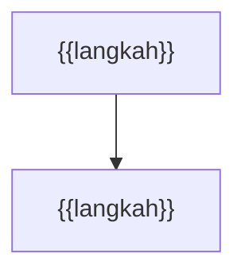

<!-- TEMPLAT 02-user-flows. Teks heading `Daftar flow` dan `F0 -` adalah kontrak (lihat references/contract.md). Tiap flow berjudul `F<n> - <nama>` dan memuat satu blok Mermaid (maks. sekitar 25 simpul). Isi setiap {{...}}, lalu hapus semua komentar ini. -->

# 02 - User Flows: {{nama proyek}}

Merujuk `01-PRD.md`: ID konflik `C1..`, requirement `FR-n`. Transisi tanpa pemicu di prototype atau dokumen sumber ditandai `[ASUMSI]` di catatan.

## Daftar flow
| # | Flow | Modul atau halaman |
| --- | --- | --- |
| F0 | {{Navigasi}} | {{semua}} |
| F1 | {{flow}} | {{halaman}} |

## F0 - {{Navigasi}}

Catatan: {{enum persis seperti di kode, konflik PRD C<n>, [ASUMSI]}}

## F1 - {{nama flow}}

Catatan: {{...}}
